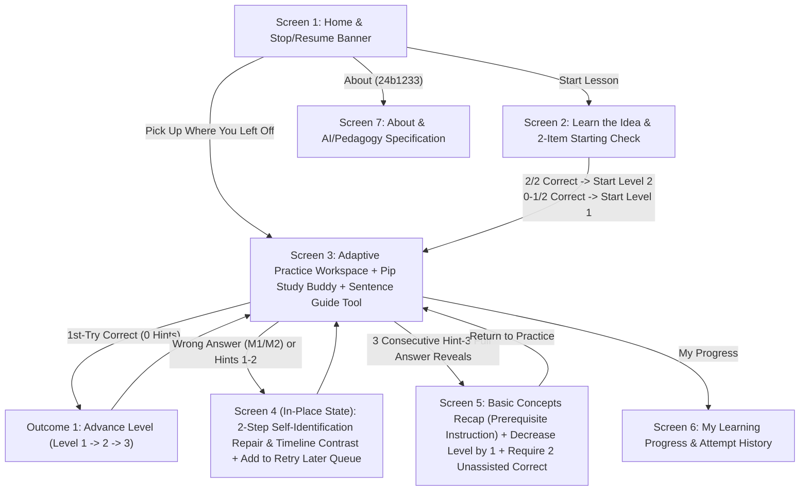

# ET 617 End-Semester Examination Report — TimeBridge English (`24b1233`)

---

## Identity Card

| Field | Selection |
| :--- | :--- |
| **Roll No. / Identity Token (`ID`)** | `24b1233` |
| **Problem Statement (`P`)** | **P4** — Adaptive tutor with automatic question generation |
| **Topic (`T`)** | **P4-T7** — English tenses: simple past vs present perfect (ESL) |
| **Learner Context (`L`)** | **L1** — Class 6–8 student in a rural government school, regional-language medium, uses a parent's Android phone for about 30 minutes in the evening |
| **Design Constraint (`C`)** | **C4** — 10-minute sessions (One complete learning sequence fits in 10 minutes; the learner can stop and resume where they left off) |
| **Live Application URL** | https://et617-24b1233.netlify.app |
| **GitHub Repository URL** | https://github.com/tejask-42/et617-endsem-24b1233 |

---

## D1 — Educational Problem

### Educational Problem (4 Sentences)
Class 6–8 students in rural regional-language medium government schools (L1) typically encounter English grammar as isolated rules to memorize and struggle to distinguish between the **Simple Past** (*"My mother bought fresh tomatoes yesterday morning"*) and the **Present Perfect** (*"Meena has lost the key, so she cannot open the lock right now"*). Because their home language often maps both meanings onto a single past-completive construction, learners frequently attach `have/has + past participle (V3)` to finished past timestamps or use the Simple Past (`V2`) when describing an action whose result still holds at the present moment. Static worksheets practiced on a parent's shared smartphone in the evening fail to diagnose *why* a learner picked the wrong verb form or adapt to how many hints they needed. **TimeBridge English** solves this problem through a pressure-free, 10-minute stop-and-resume adaptive tutor (C4) that guides learners to self-identify time clues, supports them with a 3-step progressive hint ladder and an interactive Sentence Guide tool, and adapts across three question formats and difficulty tiers.

### Three Measurable Learning Outcomes
1. **LO1 — Classify Time Windows (Understand):** Given an everyday sentence with an explicit or situational time cue, the learner will **classify** whether the action belongs to a **finished past time period** (Simple Past) or **connects to a present result right now** (Present Perfect) with at least 80% accuracy.
2. **LO2 — Construct Accurate Verb Phrases (Apply):** Given a subject, a base verb (`V1`), and a situational context, the learner will **construct** the grammatically accurate verb phrase (`V2` vs `has/have + V3`) without subject-auxiliary agreement (`has` vs `have`) or participle form errors across at least 4 of 5 tasks.
3. **LO3 — Explain & Fix Tense Errors (Analyze / Evaluate):** Given a sentence containing a common ESL tense error, the learner will **explain** in one sentence *why* Simple Past or Present Perfect is required by identifying whether the time window is already finished or the outcome still affects the present moment.

### Context of Use
- **Where & When:** At home in a rural town or village for 10 to 30 minutes in the evening (around 7:30 PM–8:00 PM).
- **On What Device:** On a parent's low-cost Android smartphone (360 px portrait screen). Because a parent may need the phone back for a call or message at any moment, sessions are structured as calm, bite-sized sequences that fit comfortably within **10 minutes (C4)** without a stressful countdown timer and save automatically to `localStorage` so the student can **Pick Up Where They Left Off**.

---

## D2 — Learner Persona (Expanded from Seed L1)

- **Name & Age:** **Aarav Patil**, 13 years old (Class 8 student in a rural government school in Maharashtra, Marathi medium).
- **Language:** Speaks Marathi at home and at school. He is trying to learn practical, conversational English for the first time outside routine school exams.
- **Motivation:** Aarav is fascinated by the English language because he watches English action and adventure movies on TV. He is self-motivated to understand natural English sentences and express everyday events clearly, rather than cramming definitions for school tests.
- **Device & Time:** Borrows his father's Android smartphone for about 20–30 minutes in the evening. He needs short, self-contained 10-minute sessions (C4) with a clear **Save & Stop for Now** button and a Dark Mode toggle for comfortable evening reading.
- **Prior Knowledge of Prerequisites:**
  - Knows basic pronouns (*I, we, you, they, he, she, it*) and everyday verbs (*buy, rain, arrive, win, eat, repair, visit, lose, submit, finish*).
  - Has heard past forms (*bought, went, lost*) and phrases with *have/has*, but treats `V2` and `have/has + V3` as interchangeable ways of talking about the past and occasionally confuses singular `has` with plural `have`.
- **Two Likely Misconceptions:**
  1. **Misconception 1 (`M1`) — Pairing Present Perfect (`have/has + V3`) with a Finished Past Time Marker:**
     - Aarav assumes that adding `have` or `has` before a past verb simply makes English sound "more complete or formal," so he pairs `have/has + V3` with finished past time expressions like *yesterday morning*, *last Sunday*, or *two hours ago* (e.g., *"I have visited my grandmother's village last Sunday"* instead of *"I visited..."*).
  2. **Misconception 2 (`M2`) — Using Simple Past (`V2`) when the Action Connects to a Present Result Right Now:**
     - Whenever an action occurred before the current second, Aarav defaults to Simple Past (`V2`), ignoring that the sentence emphasizes a **visible result right now** or uses unfinished markers like *already*, *yet*, or *just* (e.g., *"Grandfather lost his glasses, so he cannot read the newspaper right now"* instead of connecting the past action to the present inability to read using *"has lost"*).

---

## D3 — Educational Content

### 1. Conversational Concept Explanation ("Learn the Idea" Screen)
Written in conversational active voice (`"Let us picture time in two simple ways..."`) with visual callout boxes and numbered cues (`First`, `Second`, `Third`):
- **First · Finished Past Time (Simple Past — `V2`):** *"When a sentence mentions a finished past time like `[yesterday]`, `[last Sunday]`, or `[two hours ago]`, that time box is closed. We use Simple Past: 'My mother `[bought]` vegetables `[yesterday morning]`.'"*
- **Second · Connected to Right Now (Present Perfect — `have / has + V3`):** *"When a past action leaves a result we can still see right now (or uses words like `[already]`, `[yet]`, or `[just]`), we build a bridge to the present using have / has + V3: 'Meena `[has lost]` the key, so she cannot open the lock `[right now]`.'"*
- **Third · Two Common Mistakes We Will Avoid Together:**
  - *Mistake 1:* Do not use `have / has + V3` when the sentence names a finished past time like `yesterday`.
  - *Mistake 2:* Do not use Simple Past when the sentence is explaining why something is true `right now`.

### 2. Core Tasks Across 3 Formats with Model Answers & Misconception Feedback

| # | Format & Level | Task Prompt | Model Answer | Feedback for Correct Response | Feedback for Misconception 1 (`M1`: Finished Past + `have/has V3`) | Feedback for Misconception 2 (`M2`: Present Result + `V2`) |
| :--- | :--- | :--- | :--- | :--- | :--- | :--- |
| **1** | **Warm-Up 1** (Multiple Choice) | *"Yesterday evening, Rohan and his sister ___ their school homework before dinner."* (`finished` / `have finished` / `has finished`) | `finished` | *"Well done! 'Yesterday evening' is a finished time in the past, so we use 'finished'."* | *"Look at 'Yesterday evening': that time is completely over. We do not use 'have finished' with a finished past time word."* | — |
| **2** | **Warm-Up 2** (Multiple Choice) | *"Look! Meena ___ the front door key, so she cannot open the lock right now."* (`has lost` / `lost` / `have lost`) | `has lost` | *"Spot on! Because she still cannot open the lock right now, 'has lost' connects the past action to this moment."* | — | *"Notice the second half: 'she cannot open the lock right now.' When the result still matters now, we use 'has lost'."* |
| **3** | **Task 1 — Level 1** (Multiple Choice) | *"My mother ___ fresh tomatoes from the village market yesterday morning."* (`bought` / `has bought` / `have bought`) | `bought` | *"Correct! 'bought' fits because 'yesterday morning' matches this time frame."* | **Step 1 Self-Check:** *"Look at the words 'yesterday morning'. What kind of time does it show?"* → **Step 2 Resolution:** *"Using 'has bought' tries to connect the action to right now, which clashes with 'yesterday morning'. Simple Past ('bought') fits any finished past time."* | — |
| **4** | **Task 2 — Level 1** (Multiple Choice) | *"Look at the wet road outside! It ___ just ___, so the puddles are still full of water now."* (`has just rained` / `rained` / `have just rained`) | `has just rained` | *"Correct! 'has just rained' fits because 'just / puddles are still full now' matches this time frame."* | — | **Step 1 Self-Check:** *"Why does the speaker tell us that the puddles are still full of water right now?"* → **Step 2 Resolution:** *"Simple Past treats the rain as a separate past story, missing the connection to the wet road right now. Present Perfect ('has just rained') builds a bridge to the wet road we see right now."* |
| **5** | **Task 3 — Level 1** (Time & Verb Builder) | *"Don't worry, we are not late! The school bus ___ (not / arrive) yet."* | Time Window: `Connected to Right Now` · Verb: `has not arrived` | *"Great building! You matched the right time frame and chose 'has not arrived'."* | — | **Step 1 Self-Check:** *"With the word 'yet', is the waiting period finished, or does it continue up to right now?"* → **Step 2 Resolution:** *"Treating this as a closed past time ignores that they are still waiting at the bus stop right now. The word 'yet' reaches up to this exact moment, so we use 'has not arrived'."* |
| **6** | **Task 4 — Level 2** (Time & Verb Builder) | *"Our class team ___ (win) the inter-school cricket match last Friday."* | Time Window: `Finished Past Time` · Verb: `won` | *"Great building! You matched the right time frame and chose 'won'."* | **Step 1 Self-Check:** *"Look at 'last Friday'. Is that day finished in the past, or is it still open today?"* → **Step 2 Resolution:** *"Pairing 'has won' with 'last Friday' mixes a present bridge with a closed past day. 'Last Friday' is completely over, so we use Simple Past ('won')."* | — |
| **7** | **Task 5 — Level 2** (Time & Verb Builder) | *"No thank you, I am full right now. I ___ already ___ (eat) my lunch."* | Time Window: `Connected to Right Now` · Verb: `have already eaten` | *"Great building! You matched the right time frame and chose 'have already eaten'."* | — | **Step 1 Self-Check:** *"Why does the speaker mention eating lunch when someone offers them food right now?"* → **Step 2 Resolution:** *"Without 'have already eaten', the sentence loses the direct bridge explaining why the speaker is full right now."* |
| **8** | **Task 6 — Level 3** (Spot & Explain the Error) | *"A student wrote: 'I have visited my grandmother's village last Sunday.' Write the corrected verb and explain in one short sentence why 'have visited' does not fit here."* | Verb: `visited` · Model Explanation: *"We should use 'visited' (Simple Past) because 'last Sunday' is a finished time in the past, so we cannot use 'have visited'."* | *"Excellent explanation! You identified the verb 'visited' and explained the time rule clearly."* | **Step 1 Self-Check:** *"Why does 'have visited' clash with the words 'last Sunday'?"* → **Step 2 Resolution:** *"'Have visited' connects to the present, which clashes with the finished timestamp 'last Sunday'. Replacing 'have visited' with 'visited' matches the finished past time."* | — |
| **9** | **Task 7 — Level 3** (Spot & Explain the Error) | *"Grandfather is searching the table right now. Write the Present Perfect verb phrase for '(lose)' in: 'He ___ his glasses, so he cannot read the newspaper right now,' and explain in one short sentence why Present Perfect fits."* | Verb: `has lost` · Model Explanation: *"We use 'has lost' because the result still affects him right now — he still does not have his glasses and cannot read now."* | *"Excellent explanation! You identified the verb 'has lost' and explained the time rule clearly."* | — | **Step 1 Self-Check:** *"Why do we use 'has lost' instead of just treating it as a closed past event?"* → **Step 2 Resolution:** *"'Has lost' builds the bridge showing that the past loss still prevents him from reading right now."* |

---

## D4 — Working Application (URL & Screen Map)

- **Live Hosted URL:** https://et617-24b1233.netlify.app
- **GitHub Repository:** https://github.com/tejask-42/et617-endsem-24b1233
- **Identity Token Compliance:** `ID: 24b1233` is rendered in the persistent `#identity-footer` on every screen and prominently on the **About** screen.
- **Design Constraint (`C4` — 10-Minute Sessions, Stop & Resume) Implementation:**
  - The lesson sequence is designed as a pressure-free ~8-minute session without an anxiety-inducing countdown timer.
  - Every learner interaction automatically saves to `localStorage['et617_24b1233_p4_state']`.
  - Clicking **Save & Stop for Now** (or reopening the tab later) displays a prominent **"Continue Your Saved Lesson?"** card on the Home screen with two explicit actions: **Pick Up Where You Left Off** vs **Quit & Start New Lesson**.

### Screen Map & State Transitions (6 Connected Screens)



---

## D5 — Two Contrasting Learner Scenarios

### Scenario A — Learner Who Responds Correctly (Advances Across Levels & Formats)
1. **Warm-Up Diagnostic:** The learner selects **`A) finished`** on Warm-Up 1 (*"Yesterday evening..."*) and **`A) has lost`** on Warm-Up 2 (*"...cannot open the lock right now"*). With `2/2` correct, the diagnostic places the learner directly at **Level 2 (Time & Verb Builder)**.
2. **First-Try Unassisted Correct Response:** On **Task 4 (`Q4-CRICKET`)** (*"Our class team ___ (win) the inter-school cricket match last Friday"*), the learner selects **`Finished Past Time (already over)`** and **`won`** on the first try with **0 hints** and clicks **Check Answer**.
3. **System Response (Outcome 1 — Harder Question):**
   - **Pip (Study Buddy)** bounces happily (`"Yay! Pip is jumping with joy — you got it right!"`) and the **Learning Energy Meter** increases.
   - The tutor decision card displays: **"Advancing from Level 2 to Level 3! Because you solved this on your first try with zero hints, the tutor is giving you a more challenging task next."**
   - Clicking **Next Question →** transitions the learner to **Level 3 (`Spot & Explain the Error`)**, where they must type the corrected verb (`visited`) and write a 1-sentence explanation for *"I have visited my grandmother's village last Sunday."*

### Scenario B — Learner Who Exhibits a D2 Misconception & Triggers Prerequisite Recap
1. **Exhibiting Misconception 1 (`M1`):** At **Level 1 (`Q1-MARKET`)** (*"My mother ___ fresh tomatoes from the village market yesterday morning"*), the learner selects **`B) has bought`** (pairing Present Perfect with a finished past time) and clicks **Check Answer**.
2. **System Response — Outcome 2 (2-Step Self-Identification & Alternative Timeline Explanation + Retry Queue):**
   - **Pip (Study Buddy)** tilts with droopy sad ears (`"Aww, Pip looks a little sad — let us check the clue together!"`).
   - The question is automatically added to **`Retry Later List: 1`**.
   - **Step 1 of 2 (Self-Identification):** The tutor asks: *"Look at the words 'yesterday morning' in this sentence. What kind of time does it show?"* with two buttons (`It is a Finished Past Time` vs `It connects to Right Now`).
   - **Step 2 of 2 (Side-by-Side Resolution):** When the learner taps **`It is a Finished Past Time (already over)`**, the tutor opens a side-by-side comparison box contrasting *Why your first choice clashed* (*"Using 'has bought' tries to connect the action to right now, which clashes with 'yesterday morning'"*) with *How to fix it* (*"'Yesterday morning' is a closed box in the past. Simple Past ('bought') fits any finished past time"*).
3. **Triggering Outcome 3 (3 Consecutive Hint-3 Reveals → Basic Concepts Recap & Level Step-Down):**
   - When the learner is unable to solve **3 questions in a row** and clicks **`Get Hint 1` → `Get Hint 2` → `Get Hint 3`** (revealing the full answer three consecutive times), the tutor automatically transitions to the **Basic Recap** screen (`Screen 5`), displays the foundational building-block table (`I/We/You/They -> have + V3` vs `He/She/It -> has + V3`), **lowers the learner's difficulty level by 1**, and activates **Building Steady Confidence Mode** (requiring **2 consecutive unassisted correct answers** before leveling up again).

---

## D6 — AI Functionality Specification

TimeBridge English specifies two generative/evaluative AI capabilities with strict output verification and an always-available deterministic offline engine:

### 1. Adaptive Everyday Question Generator
- **What the AI Does:** Generates a fresh, context-appropriate ESL question (Simple Past vs Present Perfect) matched to the learner's current difficulty level (`1`, `2`, or `3`), target format (`mcq`, `builder`, or `explanation`), and most frequent misconception (`M1` or `M2`).
- **Actual Input / Prompt Sent:**
  ```text
  System: You are an ESL pedagogical item generator for Class 6-8 Indian students.
  Input JSON: {
    "learnerLevel": 2,
    "targetMisconception": "M1_present_perfect_with_finished_past_time",
    "format": "builder",
    "contextDomain": "everyday_home_or_school"
  }
  Task: Output strict JSON with fields {
    "prompt", "timeCue", "expectedWindow",
    "correctVerbChoice", "verbChoices",
    "hints": ["Hint 1...", "Hint 2...", "Hint 3..."],
    "selfCheckPrompt", "contrastChosenText", "contrastTargetText"
  }.
  ```
- **Sample Output:**
  ```json
  {
    "id": "GEN-2-M1-1",
    "level": 2,
    "format": "builder",
    "contextTitle": "Helping at Home",
    "prompt": "My elder brother ___ (clean) the water tank last Saturday.",
    "timeCue": "last Saturday",
    "correctWindowChoice": "closed_past",
    "correctVerbChoice": "cleaned",
    "verbChoices": ["cleaned", "has cleaned", "have cleaned"],
    "hints": [
      "Hint 1: Look closely at \"last Saturday\". Is that time already over, or does the result matter right now?",
      "Hint 2: Because \"last Saturday\" is finished, choose \"Finished Past Time\" and \"cleaned\".",
      "Hint 3: Choose \"Finished Past Time\" and \"cleaned\"."
    ]
  }
  ```
- **How the Output Is Checked Before the Learner Sees It:** The validator verifies that (1) `hints` is an array of exactly 3 non-empty strings, (2) `correctVerbChoice` is present inside `verbChoices`, (3) `correctWindowChoice` is either `'closed_past'` or `'bridge_now'`, and (4) sentence length is $\le 22$ words using age-appropriate vocabulary.
- **Fallback When It Fails or Is Offline:** `generateDynamicQuestion(targetLevel, targetFocusArea, counter)` in `src/content.js` deterministically synthesizes verified everyday items across all 3 formats (`mcq` at Level 1, `builder` at Level 2, `explanation` at Level 3) from parameterized subject–verb–time matrices.

### 2. Open Explanation & Misconception Evaluator (Format 3)
- **What the AI Does:** Evaluates the learner's typed verb correction and 1-sentence free-text explanation in Level 3 tasks to verify whether they corrected the verb AND articulated why the time window is finished or connected to right now.
- **Actual Input / Prompt Sent:**
  ```text
  System: Evaluate a Class 8 ESL student's 1-sentence grammar explanation.
  Input JSON: {
    "flawedSentence": "I have visited my grandmother's village last Sunday.",
    "timeCue": "last Sunday",
    "expectedWindow": "closed_past",
    "acceptedVerbs": ["visited"],
    "studentVerb": "visited",
    "studentExplanation": "Because last Sunday is already finished in the past."
  }
  Task: Return JSON {
    "verbCorrect": true,
    "conceptUnderstood": true,
    "misconceptionDetected": null,
    "encouragingFeedback": "Excellent explanation! You identified 'visited' and explained that 'last Sunday' is a finished past time."
  }.
  ```
- **How the Output Is Checked Before the Learner Sees It:** Verifies that `verbCorrect` agrees with the exact normalized ground-truth verb list (`acceptedVerbs`) so the model can never hallucinate a wrong verb key, and confirms `encouragingFeedback` is non-empty and supportive.
- **Fallback When It Fails or Is Offline:** `evaluateLearnerResponse(question, userInput)` in `src/pedagogy.js` runs an instant deterministic check matching `acceptedVerbs` plus concept keywords (`requiredConceptKeywords` such as `last sunday`, `finished`, `past`, `over`, `now`, `still`, `result`) and word-count validation ($\ge 3$ words).

---

## D7 — Pedagogical Rationale

### 1. How the Design Supports Learning, Feedback & Scaffolding
- **Conversational Cognitive Engagement (`Rubric P5` & `C3`):** Rather than presenting dry linguistic terminology (*"present perfective aspect"*), the app uses conversational active voice (*"Let us picture time in two simple ways..."*, *"First, Second, Third"*) and colour-coded visual boxes (`.highlight-time` in amber and `.highlight-verb` in green) so a 13-year-old Marathi-medium student (`L1`) can immediately map form to meaning.
- **Two-Step Error Self-Identification (`Rubric P2`):** When Aarav makes a mistake, the tutor does not simply mark him wrong or hand him the answer. Instead, **Step 1** prompts *him* to self-identify the time window (*"Look at 'yesterday morning' — is it a Finished Past Time or Connected to Right Now?"*). Once he taps an option, **Step 2** displays a side-by-side timeline comparison showing why his initial choice clashed and how to resolve it.
- **Graduated 3-Step Hint Ladder & Retrieval Queue (`ZPD` & `Atkinson-Shiffrin Memory Model`):** Learners can request up to 3 progressive hints: **Hint 1** points out the time clue, **Hint 2** gives the verb structure rule, and **Hint 3** reveals the full answer. Because an answer solved with hints (or revealed by Hint 3) is held only in short-term working memory, the tutor automatically pushes that item into the **Retry Later** queue so the learner must retrieve it independently later in the session.
- **Topic-Specific Problem-Solving Tool (`Rubric T6`):** The collapsible **Sentence Guide** tool on the practice screen lets Aarav pick any subject (*I, We, They, My mother, Rohan, She*), pick any of the 13 everyday practice verbs, and toggle between `Finished Past Time (Yesterday)` and `Connected to Right Now` to inspect how the sentence and verb conjugation change before submitting his answer.

### 2. Explicit Answer to the P4 Design Challenge (The 3-Way Decision Rule)
> **Design Challenge:** *How does the tutor decide whether the learner needs a harder question, an alternative explanation or prerequisite instruction? State the decision rule and show each of the three outcomes.*

Our tutor tracks three dimensions (`Rubric P13_CP`): **(1) Learner Profile** (set by the 2-question warm-up check), **(2) Learner Performance** (first-try accuracy and `M1`/`M2`/`PREREQ` error tags), and **(3) Learner Interaction** (`hintsUsedOnCurrent`, `consecutiveHint3Reveals`, and `toolClicks`). After every question, `applyAdaptiveDecisionRule()` in `src/pedagogy.js` executes this rule:

1. **Outcome 1 — Harder Question (`SOLVED_FIRST_TRY_NO_HINTS`):**
   - **Rule:** `IF (isCorrect == true AND hintsUsedOnCurrent == 0 AND wrongAttemptsOnCurrent == 0)`
   - **System Action:** Resets `consecutiveHint3Reveals = 0` and increments `consecutiveUnassistedCorrect`. If the learner is in normal mode, `currentLevel` increases by 1 (`Level 1 Multiple Choice` → `Level 2 Time & Verb Builder` → `Level 3 Spot & Explain the Error`). If the learner is in **Building Steady Confidence Mode** after a level step-down, they must achieve **2 consecutive unassisted correct answers** (`RECOVERY_STREAK_REQUIRED = 2`) before advancing back up.
2. **Outcome 2 — Alternative Explanation & Guided Retry (`M1/M2 Error` or `SOLVED_WITH_HINTS`):**
   - **Rule:** `ELSE IF (wrongAttempt on M1/M2 OR hintsUsedOnCurrent in [1, 2])`
   - **System Action:** Resets `consecutiveUnassistedCorrect = 0`, opens the **2-Step Self-Identification & Side-by-Side Timeline Comparison Card** (Alternative Explanation tailored to `M1` or `M2`), and adds `question.id` to `retryQueue` so the item returns later in the session.
3. **Outcome 3 — Prerequisite Instruction & Level Step-Down (`REVEALED_BY_HINT_3` 3 Times Consecutively):**
   - **Rule:** `ELSE IF (hintsUsedOnCurrent == 3 [Full Answer Revealed] AND consecutiveHint3Reveals reaches 3)`
   - **System Action:** Because the learner could not solve 3 consecutive tasks even with Hints 1 and 2 and had to reveal the full answer three times in a row, the tutor:
     1. Automatically routes the learner to **Screen 5: Basic Concepts Recap (Prerequisite Instruction)** covering the foundational subject-auxiliary table (`I/We/You/They -> have + V3` vs `He/She/It -> has + V3`) and regular/irregular `V1 → V2 → V3` verb forms.
     2. **Decreases the learner's difficulty level by 1** (`currentLevel = Math.max(1, currentLevel - 1)`).
     3. Activates **Building Steady Confidence Mode** (`inRecoveryMode = true`), requiring **2 consecutive unassisted correct answers** before the learner can advance to the next level.

### 3. How Learner Context (`L1`) and Design Constraint (`C4`) Shaped Our Choices
- **No Countdown Clock Anxiety (`L1` + `C4`):** Because Aarav is willingly learning English for the first time in the evening on his father's phone, a ticking 10:00 countdown timer would raise his affective filter and penalize reading hints. Instead, we designed the sequence to complete naturally in ~8 minutes and implemented instant `localStorage` persistence with a **Save & Stop for Now** button and a **Pick Up Where You Left Off** vs **Quit & Start New Lesson** banner on the Home screen.
- **Affective Visual Feedback ("Pip the Study Buddy") & Dark Mode:** Added a lightweight SVG puppy companion (**Pip**) and **Learning Energy Meter** that responds warmly to correct and wrong attempts, plus a one-tap **Dark Mode** toggle for evening phone use.

---

## D8 — Evaluation Plan

### 1. Assessing Each Learning Outcome in D1

| Learning Outcome | Assessment Tasks & Rubric | Target Success Criterion |
| :--- | :--- | :--- |
| **LO1 — Classify Time Windows (Understand)** | Assessed via the **Time Frame Step** of Format 2 (`Time & Verb Builder`) and the **Step 1 Self-Identification Check** on error repair cards (`Finished Past Time` vs `Connected to Right Now`). | Learner classifies at least **80% (4 of 5)** of time windows accurately on the first attempt without hints. |
| **LO2 — Construct Accurate Verb Phrases (Apply)** | Assessed across Format 1 (`Multiple Choice`), Format 2 (`Verb Phrase Builder`), and delayed **Retry Later** items requiring `V2` vs `has/have + V3`. | Learner achieves at least **4 of 5** correct verb constructions and successfully clears **100% of items in the Retry Later queue** on their second encounter with 0 hints. |
| **LO3 — Explain & Fix Tense Errors (Analyze / Evaluate)** | Assessed via Format 3 (`Spot & Explain the Error` at Level 3) using a 2-point rubric:<br>- **1 pt (Verb Accuracy):** Supplies the exact corrected verb (`visited`, `has lost`, `submitted`).<br>- **1 pt (Conceptual Reasoning):** Explains *why* by referencing the closed past timestamp (`last Sunday`, `two hours ago`) or ongoing present result (`cannot read right now`). | Learner scores **2 / 2** on at least two Level 3 explanation tasks without needing Hint 3 answer reveal. |

### 2. Log Data Collected by the Application
In `src/state.js` (`localStorage['et617_24b1233_p4_state']`), the application automatically logs:
- `diagnosticAnswers` and `profileLevel` (initial baseline level 1 vs 2),
- `attemptHistory[]`: per-question record of `{ questionId, title, format, outcome, hintsUsed, levelAfter }`,
- `misconceptionLog`: frequency counts of `{ M1, M2, PREREQ }` errors across the session,
- `retryQueue[]` and `consecutiveUnassistedCorrect`: tracking whether previously assisted items were later solved independently,
- `recapTriggeredCount` and `toolClicks`: measuring how often prerequisite instruction and the interactive Sentence Guide tool were used.

### 3. What Result Counts as Overall Session Success
A learner session is evaluated as successful when:
1. The learner advances at least **one full difficulty tier** above their starting level (or, if stepped down to the Basic Recap, successfully completes the **2-consecutive-unassisted-correct** recovery streak),
2. The frequency of `M1` and `M2` errors drops on subsequent tasks targeting the same time frame, and
3. The **Retry Later** queue is emptied (`retryQueue.length === 0`) by solving previously assisted questions without hints.

---

## AI-Use Log and Reflection

### 1. Chronological Log of AI Tool Usage
1. ** tool used:** Antigravity AI Assistant (single continuous session in workspace `ET617`; full transcript exported from session logs).
2. **Order of Tasks Performed with AI:**
   - **Phase 1 (Exam Card & Pedagogical Design):** Analyzed the `P4` problem statement and selected `P4-T7` (Simple Past vs Present Perfect), `L1` (Class 6–8 rural government school student using parent's Android phone in the evening), and `C4` (10-minute sessions with stop & resume). Co-designed the `DESIGN.md` specification.
   - **Phase 2 (Initial Scaffold & First Deployment):** Generated the vanilla HTML/CSS/ES-Module shell (`index.html`, `styles.css`, `src/state.js`, `src/content.js`, `src/app.js`) with `localStorage` stop-and-resume persistence and deployed live to `https://et617-24b1233.netlify.app`.
   - **Phase 3 (Adaptive Engine & Three Question Formats):** Implemented `src/pedagogy.js` with the 3-step progressive hint ladder, Retry Later queue, 3-consecutive-Hint-3-reveal Basic Concepts Recap + level step-down, 2-unassisted-correct stabilization streak, and the interactive Sentence Guide tool.
   - **Phase 4 (UX Refinement, Study Buddy & Independent Audit):** Added Dark Mode, simplified learner-facing labels, added Pip the Study Buddy SVG + Learning Energy Meter, ran an independent rubric audit, and fixed dynamic question retry lookup (`getQuestionById`).

### 2. Reflection on Human Judgment vs AI Output
- **What I Rejected or Changed from AI Suggestions:**
  1. **Rejected an Explicit 10-Minute Countdown Timer for C4:** The AI initially proposed a ticking `10:00` countdown clock in the header to satisfy Constraint C4. I rejected this because our persona Aarav is a self-motivated beginner learning English willingly in the evening; a ticking countdown timer adds unnecessary test anxiety. Instead, I directed the design toward a calm ~8-minute session sequence with explicit **Pick Up Where You Left Off** vs **Quit & Start New Lesson** buttons.
  2. **Designed the Exact 3-Hint / Retry-Queue / 3-Consecutive-Reveal Step-Down Rule:** Rather than a simplistic "wrong answer = easier question" rule, I specified the exact scaffolding logic: 1st-try correct with 0 hints advances the level; solving with Hints 1–2 queues the item for **Retry Later**; and failing to solve 3 questions in a row (reaching Hint 3 full-answer reveal 3 consecutive times) triggers the **Basic Concepts Recap**, decreases the student's level, and enforces a streak of unassisted correct answers before advancing again.
  3. **Removed Internal Planning Jargon & Diversified Contexts:** The AI initially left internal labels (`Slice 1`, `(C4)`, `(Time Clue)`, `Open Time-Bridge & Verb Helper`) in the learner UI and leaned heavily on movie examples. I instructed the AI to strip all internal planning terms from the UI and commit logs, simplify button labels to intuitive words (`Get Hint 1`, `Guide`), broaden questions to everyday Indian contexts (weekly market, rain puddles, school bus, cricket match, lunch, bicycle chain, homework), and add **Pip the Study Buddy** with an energy bar for visual engagement.
